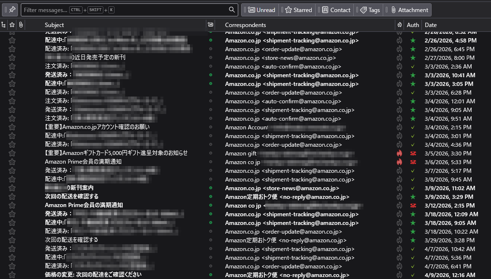
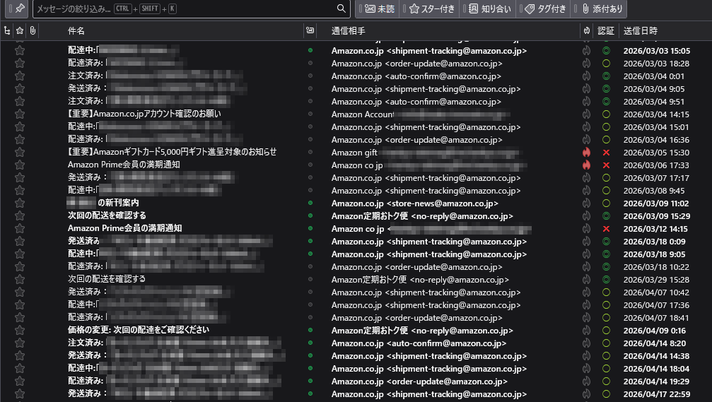

# Auth Status Column

A Thunderbird add-on that adds a column to the message list showing SPF/DKIM results at a glance. Hover over a symbol for details.

[日本語](#日本語)

| Symbol | Meaning |
|---|---|
| ★ | SPF and DKIM both pass |
| ✓ | One passes, the other has no result |
| ? | No results, or could not be evaluated (permerror etc.) |
| ☠ | Either one failed |
| – | No authentication header (e.g. internal mail, not checked) |

Mail spoofing a domain is caught as ☠. Mail that only borrows a name like "Amazon" but is sent from its own domain passes authentication, so check the sender's domain too.

## Install

1. Download `auth-status-column-x.x.xpi` from [Releases](../../releases).
2. In Thunderbird, open **Tools → Add-ons and Themes**, click the gear icon → **Install Add-on From File…** and select the file.
3. Right-click the message list column header, check **Auth**, and drag it wherever you like.

Requires Thunderbird 153 ESR. Updates are not automatic; check Releases for new versions.

## Notes

- Results are read from the `Authentication-Results` / `ARC-Authentication-Results` headers added by your receiving server. The add-on performs no verification itself and makes no network connections.
- It uses a Thunderbird Experiment API (there is no official API for custom columns), so it may break on future Thunderbird versions. For this reason it is not listed on addons.thunderbird.net.

---

## 日本語

メール一覧に、SPF・DKIMの認証結果を記号で表示する列「認証」を追加するThunderbirdアドオンです。記号にマウスを乗せると各方式の結果が表示されます。

| 記号 | 意味 |
|---|---|
| ◎ | SPF・DKIMとも合格 |
| ○ | 片方が合格、片方は結果なし |
| △ | どちらも結果なし、または判定不能（permerror等） |
| ✕ | どちらかが失敗 |
| ◇ | 認証ヘッダーなし（社内メールなど未検証） |

ドメインを偽装したメールは✕で見抜けます。名前だけ「Amazon」を名乗り、自分のドメインから送られたメールは認証を通るため、送信元ドメインもあわせて確認してください。

### インストール

1. [Releases](../../releases) から `auth-status-column-x.x.xpi` をダウンロードします。
2. Thunderbirdで **ツール → アドオンとテーマ** を開き、歯車アイコン → **ファイルからアドオンをインストール** で選びます。
3. 一覧の列見出しを右クリックし「認証」にチェックを入れて、好きな位置へドラッグしてください。

Thunderbird 153 ESR 用です。自動更新はないので、新しい版は Releases を確認してください。

### 注意

- 受信サーバーが付けた `Authentication-Results` / `ARC-Authentication-Results` ヘッダーを読み取って表示します。アドオン自身は検証を行わず、外部への通信もしません。
- 列を追加する公式APIがないため、Thunderbirdの内部API（Experiment）を使っています。将来のThunderbirdで動かなくなる可能性があり、そのため addons.thunderbird.net には掲載していません。

## License

MIT
